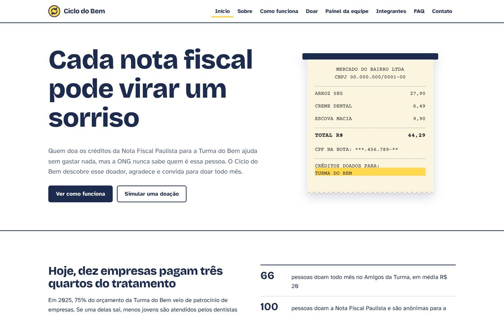
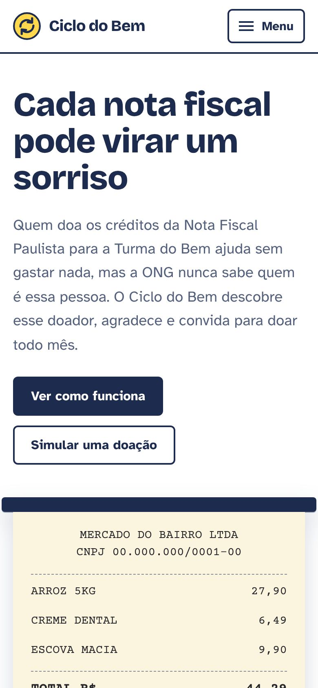
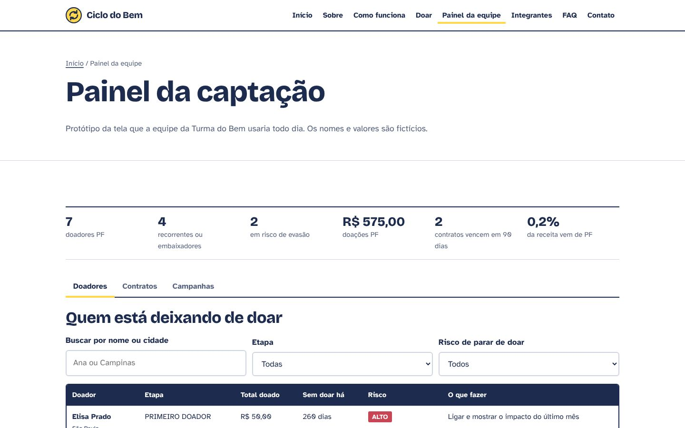
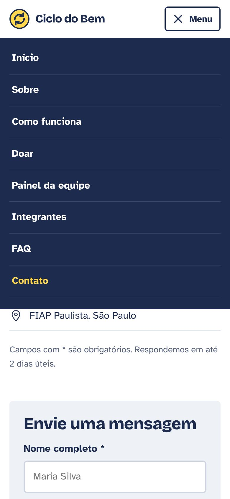
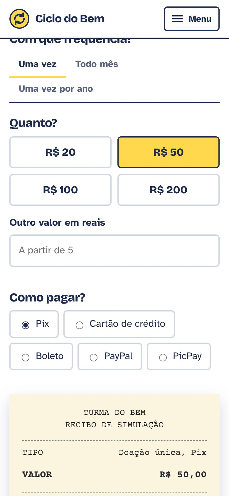

# Ciclo do Bem

Proposta de plataforma para a ONG Turma do Bem encontrar e manter doadores e patrocinadores. Quem doa os créditos da Nota Fiscal Paulista hoje é anônimo para a ONG; o Ciclo do Bem identifica essa pessoa, convida para a doação mensal, avisa a equipe quando alguém está deixando de doar e lembra dos contratos de patrocínio 90 dias antes do vencimento.

Este repositório é o site do projeto, entregue na Sprint 2 do Challenge FIAP 2026 (Front-End Design Engineering).

- Site publicado: https://asaffeggmsmfj.github.io/ciclo-do-bem/
- Repositório: https://github.com/Asaffeggmsmfj/ciclo-do-bem

## Sprint 2: o que mudou

O site da Sprint 1 só funcionava no computador. Nesta sprint ele foi redesenhado do zero, ficou responsivo e ganhou JavaScript.

### Interatividade em JavaScript

| O que faz | Página | Arquivo |
|---|---|---|
| Menu hambúrguer: abre e fecha pelo botão, ao clicar num link ou com a tecla Esc | todas | `js/main.js` |
| Botão de voltar ao topo e ano atual no rodapé | todas | `js/main.js` |
| Validação do formulário sem o atributo `required`: campos obrigatórios, formato de e-mail e telefone, tamanho mínimo da mensagem, autorização LGPD, mensagem de erro em cada campo, borda vermelha e `preventDefault()` | Contato | `js/contato.js` |
| Campo "nome da empresa" que só aparece quando o assunto é empresa, e contador de caracteres | Contato | `js/contato.js` |
| Perguntas que abrem e fecham, e filtro por assunto | FAQ | `js/faq.js` |
| Jornada do doador: cada etapa clicada mostra o que a plataforma faz nela | Como funciona | `js/solucao.js` |
| Simulador de doação com as regras do projeto (mínimo de R$ 5, doação mensal só no cartão), recibo atualizado na hora e leitura do link que o chatbot envia (`doar.html?valor=30&forma=cartao_credito&tipo=mensal`) | Doar | `js/doar.js` |
| Conferência do comprovante da Nota Fiscal Paulista, com a mesma regra usada pelo chatbot | Doar | `js/doar.js` |
| Painel da equipe: números calculados, abas, busca, filtros por etapa e por risco de parar de doar, contratos com aviso de 90 dias e progresso das campanhas | Painel da equipe | `js/painel.js` |

### Responsividade

O CSS foi escrito primeiro para o celular, e as media queries ficam no fim de cada arquivo:

- até 767 px: uma coluna, menu hambúrguer, tabelas com rolagem própria;
- a partir de 768 px (tablet): duas colunas;
- a partir de 992 px (desktop): menu horizontal, três e quatro colunas;
- a partir de 1300 px: container mais largo e títulos maiores.

Testado em 360, 768, 1024 e 1440 px, sem rolagem horizontal em nenhuma página.

### Visual

O elemento central do site é o cupom fiscal: na página inicial ele "sai da impressora" uma vez ao carregar, e no simulador o resumo da doação aparece como recibo. Cores: azul-marinho `#1d2b4f`, amarelo `#ffd84d` e vermelho `#c94455`. Fontes Bricolage Grotesque (títulos), Atkinson Hyperlegible (texto, feita para leitura fácil) e Courier Prime (só no cupom), todas de licença livre e salvas em `assets/fontes`.

## Prints

| Início no computador | Início no celular |
|---|---|
|  |  |
| **Painel da equipe** | **Menu aberto e simulador no celular** |
|  |   |

## Tecnologias

- HTML5 semântico (`header`, `nav`, `main`, `section`, `article`, `aside`, `footer`)
- CSS3 com variáveis, Flexbox, Grid e media queries, sem frameworks
- JavaScript puro em arquivos externos, sem bibliotecas
- Git e GitHub para versionamento, GitHub Pages para publicação

## Estrutura de pastas

```
ciclo-do-bem/
├── index.html          Início: o problema e a jornada
├── sobre.html          Contexto, tecnologias e etapas do projeto
├── solucao.html        Como funciona: jornada, Nota Fiscal Paulista e empresas
├── doar.html           Simulador de doação e conferência do comprovante
├── painel.html         Protótipo do painel da equipe
├── integrantes.html    Integrante
├── faq.html            Perguntas frequentes
├── contato.html        Formulário de contato validado
├── css/
│   ├── style.css       Base, cabeçalho, rodapé e componentes
│   └── paginas.css     Estilos de cada página
├── js/
│   ├── main.js         Menu, voltar ao topo e funções comuns
│   ├── contato.js
│   ├── faq.js
│   ├── solucao.js
│   ├── doar.js
│   └── painel.js
├── assets/
│   ├── fontes/         Fontes (woff2) e licença
│   ├── imagens/        Logo, foto e prints
│   └── icones/         Ícones SVG
├── docs/
│   └── BACKLOG.md      Backlog com requisitos e regras de negócio
└── README.md
```

## Como abrir

Acesse o link publicado ou baixe o repositório e abra o `index.html` no navegador. Não precisa instalar nada.

## Autor

| Foto | Nome | RM | Turma | Links |
|---|---|---|---|---|
|  | Asaffe Gabriel Galdino Dos Santos | 574554 | 1TDSPB | [GitHub](https://github.com/Asaffeggmsmfj), [LinkedIn](https://www.linkedin.com/in/asaffe-gabriel-bb4288302/) |

## Contato

- E-mail: projetotdbfiap@gmail.com
- Chatbot Cici no Telegram: @turmadobem_asaffe_bot

---

Projeto acadêmico do Challenge FIAP 2026. Não é um site oficial da Turma do Bem. Os nomes e valores do painel são fictícios.
